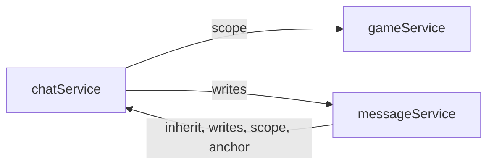

<!-- Generated by quickdraw-docs from the app's contracts. Do not edit: change the contract and run quickdraw-docs again. -->

# API reference

One page per service, generated from its contract by `quickdraw-docs`.

| Service                                   | Description                                                                                                                                           | Methods | Collections | Streams | Channels | Events |
| ----------------------------------------- | ----------------------------------------------------------------------------------------------------------------------------------------------------- | ------- | ----------- | ------- | -------- | ------ |
| [chatService](chatService.md)             | Chats between users: create, rename and delete chats, and invite, remove and change the level of their members.                                       | 17      | 1           | 0       | 0        | 1      |
| [definitionService](definitionService.md) | Data-driven game content (tunables, items, spells), addressed by type and key: anyone may read the enabled rows, and service-wide Admins edit them.   | 10      | 0           | 0       | 0        | 0      |
| [documentService](documentService.md)     | Documents a user writes and shares with other users at a level: create, read, update and delete them, and change who they are shared with.            | 16      | 0           | 0       | 0        | 0      |
| [gameService](gameService.md)             | The realtime snake game: spectate or join a world, steer and respawn a snake, and read the high scores.                                               | 18      | 0           | 3       | 2        | 8      |
| [messageService](messageService.md)       | The messages of chats: post one to a chat the caller is a member of, read a chat's history, and delete a message.                                     | 9       | 1           | 0       | 0        | 0      |
| [pushService](pushService.md)             | The Web Push endpoints of the caller's browsers, which get a notification of each new message while the user is away.                                 | 9       | 0           | 0       | 0        | 0      |
| [userService](userService.md)             | Users: anyone signed in may read a user's public profile; a user reads their own row and changes their name or image, as may a service-wide Moderate. | 10      | 0           | 0       | 0        | 0      |

## Dependencies

An arrow points from a service to another its declarations name: `inherit` (its row policy), `writes` (that service's model), `affects`, `scope` (a `{ scope, of }` access form) or `anchor` (a collection's anchor). Each service's page lists them.

