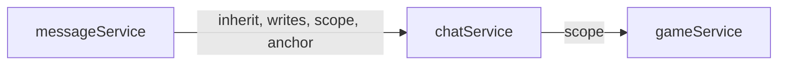

<!-- Generated by quickdraw-docs from the app's contracts. Do not edit: change the contract and run quickdraw-docs again. -->

# API reference

One page per service, generated from its contract by `quickdraw-docs`.

| Service                                   | Methods | Collections | Streams | Channels | Events |
| ----------------------------------------- | ------- | ----------- | ------- | -------- | ------ |
| [chatService](chatService.md)             | 17      | 1           | 0       | 0        | 1      |
| [definitionService](definitionService.md) | 10      | 0           | 0       | 0        | 0      |
| [documentService](documentService.md)     | 17      | 0           | 0       | 0        | 0      |
| [gameService](gameService.md)             | 13      | 0           | 1       | 1        | 4      |
| [messageService](messageService.md)       | 10      | 1           | 0       | 0        | 0      |
| [pushService](pushService.md)             | 9       | 0           | 0       | 0        | 0      |
| [userService](userService.md)             | 10      | 0           | 0       | 0        | 0      |

## Dependencies

An arrow points from a service to another its declarations name: `inherit` (its row policy), `writes` (that service's model), `affects`, `scope` (a `{ scope, of }` access form) or `anchor` (a collection's anchor). Each service's page lists them.

